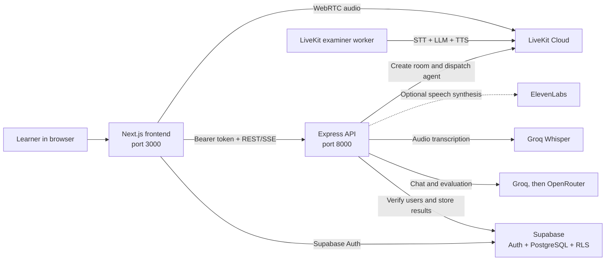

<div align="center">
  

  # IELTS AI Prep

  **An AI-powered IELTS preparation platform for personalized practice, feedback, and full exam simulation.**

  [](https://nextjs.org/)
  [](https://react.dev/)
  [](https://www.typescriptlang.org/)
  [](https://supabase.com/)
  [](https://livekit.io/)
</div>

## Overview

IELTS AI Prep brings the main IELTS preparation workflows into one authenticated web application. Learners can practise all four skills, receive band-oriented AI feedback, chat with an IELTS mentor, generate a study plan, review past attempts, and complete a consolidated exam simulation.

The repository is a small monorepo containing:

- a **Next.js frontend** for the learner experience;
- an **Express API** for authentication-aware business logic, scoring, AI evaluation, and persistence; and
- a **LiveKit worker** that conducts the simulator's real-time speaking interview.

> [!NOTE]
> This project is an independent preparation tool. It is not affiliated with, approved by, or endorsed by IELTS, the British Council, IDP, or Cambridge University Press & Assessment.

## Features

| Area | What is included |
| --- | --- |
| Authentication | Email/password and Google OAuth through Supabase Auth, protected routes, safe post-login redirects, and profile onboarding |
| Dashboard | Progress summary, recent activity, skill-level statistics, target band tracking, and performance charts |
| AI mentor | Persistent chat sessions with streamed AI responses and IELTS-focused guidance |
| Writing | Academic Task 1 and Task 2 practice, streamed band evaluation, criterion scores, corrections, suggestions, and an improved answer |
| Speaking practice | Three IELTS speaking parts, browser audio recording, Groq Whisper transcription, AI evaluation, and optional ElevenLabs examiner speech |
| Reading | Timed practice tests, answer submission, scoring, IELTS band conversion, explanations, and saved attempts |
| Listening | Audio-based tests, answer submission, band conversion, explanations, and attempt history |
| Study planner | AI-generated weekly milestones based on the learner profile, weak areas, target band, and exam date |
| Exam simulator | A combined listening, reading, writing, and speaking flow with a consolidated report |
| Live voice examiner | A dedicated LiveKit agent that runs a natural three-part IELTS speaking interview |
| Records | A unified history of writing, speaking, reading, and listening work |

## Architecture



All application API routes require a valid Supabase access token. Database Row Level Security (RLS) additionally limits each learner to their own profile, chats, submissions, attempts, and study plan.

## Technology stack

### Frontend

- Next.js 16 App Router, React 19, and TypeScript
- Tailwind CSS 4 and shadcn-style UI components
- Supabase JS for authentication and direct user-scoped reads
- TanStack Query, React Hook Form, Zod, Zustand, and Axios
- Recharts for dashboard visualizations
- LiveKit React components for real-time speaking sessions

### Backend

- Node.js, Express 5, and TypeScript
- Supabase service-role client and JWT verification
- Groq (with OpenRouter as a fallback) for mentor chat, study plans, and band evaluations
- Server-Sent Events (SSE) for streamed AI responses
- Groq Whisper for practice-audio transcription
- ElevenLabs for optional text-to-speech, with browser speech synthesis as a fallback
- Multer and Zod for uploads and request validation

### Voice agent and infrastructure

- LiveKit Agents for the real-time examiner
- LiveKit Inference for speech-to-text, language generation, turn detection, and text-to-speech
- Vercel configuration for the frontend
- Render Blueprint for the API and background worker
- Supabase PostgreSQL for persistent application data

## Repository structure

```text
ielts-platform/
├── frontend/                 # Next.js web application
│   ├── app/                  # App Router pages and layouts
│   ├── components/           # Feature and UI components
│   ├── lib/                  # Supabase client and shared helpers
│   └── public/               # Images and listening-test audio
├── backend/                  # Express REST/SSE API
│   └── src/
│       ├── controllers/      # Request handling and domain workflows
│       ├── data/             # Reading and listening test fixtures
│       ├── middleware/       # Supabase bearer-token authentication
│       ├── routes/           # API route definitions
│       ├── services/         # AI provider chain and Supabase client
│       └── utils/            # Band-score conversion and SSE helpers
├── agent/                    # LiveKit speaking examiner worker
├── supabase/                 # Supabase CLI config and schema migration
├── render.yaml               # Render API and worker Blueprint
└── package.json              # Root development commands
```

## Getting started

### Prerequisites

- [Node.js](https://nodejs.org/) **20 or newer**
- npm
- A [Supabase](https://supabase.com/) project
- A [Groq](https://console.groq.com/) API key, and optionally an [OpenRouter](https://openrouter.ai/) key as a fallback
- A [LiveKit Cloud](https://cloud.livekit.io/) project for the live speaking simulator
- Optionally, an [ElevenLabs](https://elevenlabs.io/) API key for higher-quality examiner speech in standalone speaking practice

The frontend and backend can run without LiveKit if the live speaking stage of the full simulator is not needed.

### 1. Clone and install

```bash
git clone https://github.com/meetmehta0685/ielts-platform.git
cd ielts-platform
npm run install:all
```

### 2. Create the Supabase database

The whole schema (tables, RLS policies, timestamp triggers and the profile-on-signup trigger) lives in [`supabase/migrations/20260101000000_init.sql`](supabase/migrations/20260101000000_init.sql).

**Hosted project:** create a Supabase project, then either paste the migration into the **SQL Editor** or push it with the CLI:

```bash
npx supabase link --project-ref <your-project-ref>
npx supabase db push
```

**Local (Docker):** run the full Supabase stack locally on ports `553xx`:

```bash
npx supabase start
npx supabase status   # prints the API URL, anon key and service role key
```

The main tables are `profiles`, `chat_sessions`/`chat_messages`, `writing_submissions`/`speaking_submissions`, `reading_attempts`/`listening_attempts` and `study_plans` (one row per user).

### 3. Configure authentication

Email/password authentication works with Supabase's standard email provider. To enable Google sign-in:

1. Enable **Google** under **Authentication → Providers** in Supabase.
2. Configure the Google OAuth client ID and secret.
3. Add these redirect URLs under **Authentication → URL Configuration**:
   - `http://localhost:3000/auth/callback`
   - `https://<your-frontend-domain>/auth/callback`

Also set the Supabase Site URL to the appropriate frontend origin for each environment.

### 4. Configure environment variables

Copy `frontend/.env.example` to `frontend/.env.local` and `backend/.env.example` to `backend/.env`, then fill them in.

`frontend/.env.local`:

```dotenv
NEXT_PUBLIC_SUPABASE_URL=https://your-project.supabase.co
NEXT_PUBLIC_SUPABASE_ANON_KEY=your-supabase-anon-key
NEXT_PUBLIC_API_URL=http://localhost:8000
```

`backend/.env`:

```dotenv
PORT=8000

SUPABASE_URL=https://your-project.supabase.co
SUPABASE_SERVICE_ROLE_KEY=your-supabase-service-role-key

OPENROUTER_API_KEY=your-openrouter-api-key
GROQ_API_KEY=your-groq-api-key

# Optional: standalone speaking-practice voice
ELEVENLABS_API_KEY=your-elevenlabs-api-key
ELEVENLABS_VOICE_ID=your-elevenlabs-voice-id

# Required only for the simulator's live speaking stage
LIVEKIT_URL=wss://your-project.livekit.cloud
LIVEKIT_API_KEY=your-livekit-api-key
LIVEKIT_API_SECRET=your-livekit-api-secret
LIVEKIT_AGENT_NAME=ielts-examiner
```

For the examiner worker, copy the committed example:

```bash
cp agent/.env.example agent/.env.local
```

Then add the same LiveKit URL, key, secret, and agent name used by the backend. The worker automatically falls back to `backend/.env`, so a separate `agent/.env.local` is optional during local development.

#### Environment variable reference

| Service | Variable | Required | Purpose |
| --- | --- | :---: | --- |
| Frontend | `NEXT_PUBLIC_SUPABASE_URL` | Yes | Supabase project URL |
| Frontend | `NEXT_PUBLIC_SUPABASE_ANON_KEY` | Yes | Public browser-safe Supabase anonymous key |
| Frontend | `NEXT_PUBLIC_API_URL` | Production | Express API origin; defaults to `http://localhost:8000` |
| Backend | `PORT` | No | API port; defaults to `8000` |
| Backend | `SUPABASE_URL` | Yes | Supabase project URL |
| Backend | `SUPABASE_SERVICE_ROLE_KEY` | Yes | Server-only key for authenticated database operations |
| Backend | `GROQ_API_KEY` | Yes | First provider for AI marking, the mentor and study plans, and Whisper transcription |
| Backend | `GROQ_MODELS` | No | Comma-separated Groq models tried in order; defaults to `openai/gpt-oss-120b,qwen/qwen3.8-27b,openai/gpt-oss-20b` |
| Backend | `OPENROUTER_API_KEY` | No | Last-resort AI provider when every Groq model is rate-limited |
| Backend | `OPENROUTER_MODELS` | No | Comma-separated OpenRouter fallback list (up to three); defaults to free Gemma 4 / Laguna models |
| Backend | `CORS_ORIGIN` | No | Comma-separated allowed origins; defaults to all |
| Backend | `ELEVENLABS_API_KEY` | No | Higher-quality question speech; browser TTS is used when absent |
| Backend | `ELEVENLABS_VOICE_ID` | No | ElevenLabs voice override |
| Backend + agent | `LIVEKIT_URL` | Live simulator | LiveKit WebSocket URL |
| Backend + agent | `LIVEKIT_API_KEY` | Live simulator | LiveKit server API key |
| Backend + agent | `LIVEKIT_API_SECRET` | Live simulator | LiveKit server API secret |
| Backend + agent | `LIVEKIT_AGENT_NAME` | No | Dispatch name; defaults to `ielts-examiner` |
| Agent | `LIVEKIT_STT_MODEL` | No | Defaults to `deepgram/nova-3` |
| Agent | `LIVEKIT_LLM_MODEL` | No | Defaults to `google/gemma-4-31b-it` |
| Agent | `LIVEKIT_TTS_MODEL` | No | Defaults to `inworld/inworld-tts-2` |
| Agent | `LIVEKIT_TTS_VOICE` | No | Defaults to `Ashley` |

> [!IMPORTANT]
> `SUPABASE_SERVICE_ROLE_KEY`, provider API keys, and `LIVEKIT_API_SECRET` are server secrets. Never place them in a `NEXT_PUBLIC_*` variable or commit them to Git.

### 5. Run the application

Start the complete stack from the repository root:

```bash
npm run dev
```

Or run each service in a separate terminal:

```bash
npm run dev:frontend
npm run dev:backend
npm run dev:agent
```

Open:

- Frontend: [http://localhost:3000](http://localhost:3000)
- Backend health check: [http://localhost:8000](http://localhost:8000)

If you do not need the live examiner, start only the frontend and backend.

## Available scripts

### Repository root

| Command | Description |
| --- | --- |
| `npm run install:all` | Install dependencies for the frontend, backend, and agent |
| `npm run dev` | Run all three services concurrently |
| `npm run dev:frontend` | Run the Next.js development server |
| `npm run dev:backend` | Run the Express API with automatic restart |
| `npm run dev:agent` | Run the LiveKit worker in development mode |

### Service-level checks

```bash
npm run lint --prefix frontend
npm run build --prefix frontend
npm run build --prefix backend
npm run typecheck --prefix agent
```

The project has no automated test suite. Run the build and type-check commands before opening a pull request.

## API reference

The default API base URL is `http://localhost:8000`. With the exception of the root health check, every endpoint expects:

```http
Authorization: Bearer <supabase-access-token>
```

| Method | Endpoint | Description |
| --- | --- | --- |
| `GET` | `/` | Backend health check |
| `POST` | `/api/chat/session` | Create a mentor chat session |
| `GET` | `/api/chat/sessions/:userId` | List a learner's chat sessions |
| `GET` | `/api/chat/messages/:sessionId` | Get messages for a chat session |
| `POST` | `/api/chat/stream` | Stream a mentor response over SSE |
| `POST` | `/api/writing/evaluate` | Evaluate and save a Task 1 or Task 2 response over SSE |
| `POST` | `/api/speaking/transcribe` | Transcribe a multipart `audio` upload with Groq Whisper |
| `POST` | `/api/speaking/evaluate` | Evaluate and save a speaking transcript over SSE |
| `POST` | `/api/speaking/synthesize` | Synthesize examiner speech or request browser fallback |
| `GET` | `/api/test/reading/tests` | Get the bundled reading tests |
| `POST` | `/api/test/reading/submit` | Score and save a reading attempt |
| `GET` | `/api/test/listening/tests` | Get the bundled listening tests |
| `POST` | `/api/test/listening/submit` | Score and save a listening attempt |
| `POST` | `/api/planner/generate` | Generate and save a personalized study plan |
| `GET` | `/api/planner/active` | Get the current study plan |
| `PUT` | `/api/planner/active` | Update the current study plan |
| `GET` | `/api/dashboard/stats` | Get aggregated learner dashboard metrics |
| `POST` | `/api/simulator/speaking/session` | Create a LiveKit room token and dispatch the examiner |

Chat, writing, and speaking evaluation endpoints return `text/event-stream` responses. Clients should consume `data:` frames until the final `[DONE]` event.

## Deployment

The repository includes deployment configuration for a split frontend/API/worker setup.

### Frontend on Vercel

1. Import this GitHub repository into Vercel.
2. Set the project **Root Directory** to `frontend`.
3. Add the three frontend environment variables from the table above.
4. Set `NEXT_PUBLIC_API_URL` to the public Render API URL.
5. Add the deployed `/auth/callback` URL to the Supabase redirect allow-list.

### API and examiner worker on Render

1. Create a new Render Blueprint from this repository.
2. Render will read [`render.yaml`](render.yaml) and create:
   - the `ielts-backend` web service; and
   - the `ielts-speaking-agent` background worker.
3. Enter all environment variables marked `sync: false` in the Render dashboard.
4. Use the same LiveKit project credentials and `LIVEKIT_AGENT_NAME` for both services.
5. Redeploy both services after changing LiveKit credentials or inference settings.

The API build copies the bundled reading/listening JSON data into `dist/data`, so the tests remain available in production.

## Data and security notes

- Supabase Auth is the source of identity; the API verifies every bearer token with Supabase before processing a protected request.
- RLS policies scope persisted records to the authenticated user.
- The service-role key is used only by the backend and bypasses RLS, so it must remain private.
- OAuth redirect targets are normalized to internal paths to prevent open redirects.
- AI-generated band scores and feedback are practice guidance, not official IELTS results.
- Audio uploaded for standalone speaking practice is held in memory while it is sent for transcription; the current implementation stores the transcript and evaluation, not the uploaded audio file.

## Troubleshooting

### The frontend loads, but API requests fail

Confirm that the backend is running on port `8000` and that `NEXT_PUBLIC_API_URL` has no trailing path such as `/api`. In production, verify that the value is the public HTTPS origin of the API service.

### Requests return `401`

Sign out and back in to refresh the Supabase session. Also confirm that the frontend and backend point to the same Supabase project.

### Signup succeeds but profile pages fail

Apply the migration in `supabase/migrations/` and confirm that the `on_auth_user_created` trigger exists. Existing Auth users may need a matching row inserted into `public.profiles`.

### Speaking transcription says the Groq key is missing

Set `GROQ_API_KEY` in `backend/.env` locally or in the deployed backend's environment, then restart the API.

### The simulator waits for an examiner

Make sure the agent worker is running and healthy, and confirm that the backend and agent share identical `LIVEKIT_URL`, `LIVEKIT_API_KEY`, `LIVEKIT_API_SECRET`, and `LIVEKIT_AGENT_NAME` values.

### LiveKit inference does not start

Check that inference is available for the selected LiveKit project and that the configured STT, LLM, TTS, and voice identifiers are supported. Remove agent model overrides to return to the defaults documented above.

### ElevenLabs is not configured

This is non-fatal. Standalone speaking practice returns a fallback signal and uses the browser's built-in speech synthesis instead.

## Contributing

1. Create a feature branch from `main`.
2. Keep changes scoped and do not commit environment files or credentials.
3. Run frontend lint/build, backend build, and agent type-check as relevant.
4. Open a pull request describing the learner-facing behavior and verification performed.

